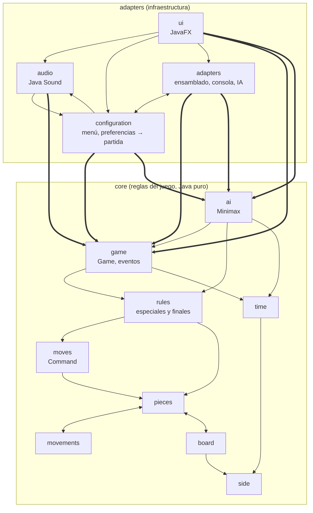

# 1. Vista general: paquetes y sentido de las dependencias

Cada flecha significa "usa". Todas las flechas que cruzan el borde van **desde los adaptadores hacia
el núcleo**: el núcleo no importa nada de afuera (ni JavaFX, ni Java Sound, ni archivos, ni hilos).
Lo que el núcleo necesita del exterior lo pide por interfaces propias, los **puertos**, que
implementa un adaptador.

Los nombres del código están en inglés; las explicaciones, en español.

## Puertos del núcleo

| Puerto (interfaz del núcleo) | Sentido | Lo implementa |
|---|---|---|
| `GameInProgress` | los adaptadores juegan (mover, deshacer, rendirse, tablas) | `Game`; lo usan la consola, el controlador del tablero y la IA |
| `GameQuery` | los adaptadores leen la partida y escuchan sus eventos | `Game`; lo usa el sonido |
| `TimeSource` | el núcleo pide la hora | `SystemTimeSource` (real), relojes falsos en los tests |
| `GameObserver` | el núcleo avisa qué pasó | `GameSounds`, `AiTurn`; `GameView` y `GameStatePanel` (vía `BoardController.listen`) |
| `GameStrategy` | el adaptador pide una jugada | `ArtificialPlayer` (núcleo); la usa `ArtificialRival` |
| `GameClock` | la partida controla el tiempo | `ChessClock`, `NoClock` (Null Object) |
| `java.util.Random` (inyectado) | azar de la IA | el ensamblado pasa uno real; los tests, uno con semilla |

Los adaptadores también tienen sus propios puertos, para no atarse a una tecnología:
`AudioPlayer` (Java Sound), `PieceRepresentation` (sprites o Unicode) y `ColorLottery` (azar del menú).

## Dependencias de ida y vuelta (aceptadas)

- `pieces ↔ board`: el tablero guarda piezas y cada pieza consulta el tablero para moverse.
- `pieces ↔ movements`: una pieza se define por sus reglas de movimiento, y las reglas miran qué
  pieza ocupa cada casilla para frenar o capturar.

La justificación está en [la decisión 3 del documento de justificación](../justificacion.md#3-paquetes-por-concepto-y-dependencias-en-un-solo-sentido).

La IA depende de la partida y no al revés: `ai → game` porque recibe una `game.GameSituation`. El
paquete `game` no conoce a la IA, que es un cliente más. (`rules` nombra a `game.FootballLayout`
solo en un comentario de documentación, que no es una dependencia.)

> **Puntos a revisar:**
> - `adapters ↔ configuration`: el ensamblado lee la configuración, y `ConfiguredGame` guarda un
>   `ArtificialRival` (del paquete `adapters`).
> - `configuration ↔ audio`: el sonido usa el `Team` de la configuración, y `Preferences` toma de
>   `VolumeControl` el volumen por defecto.
