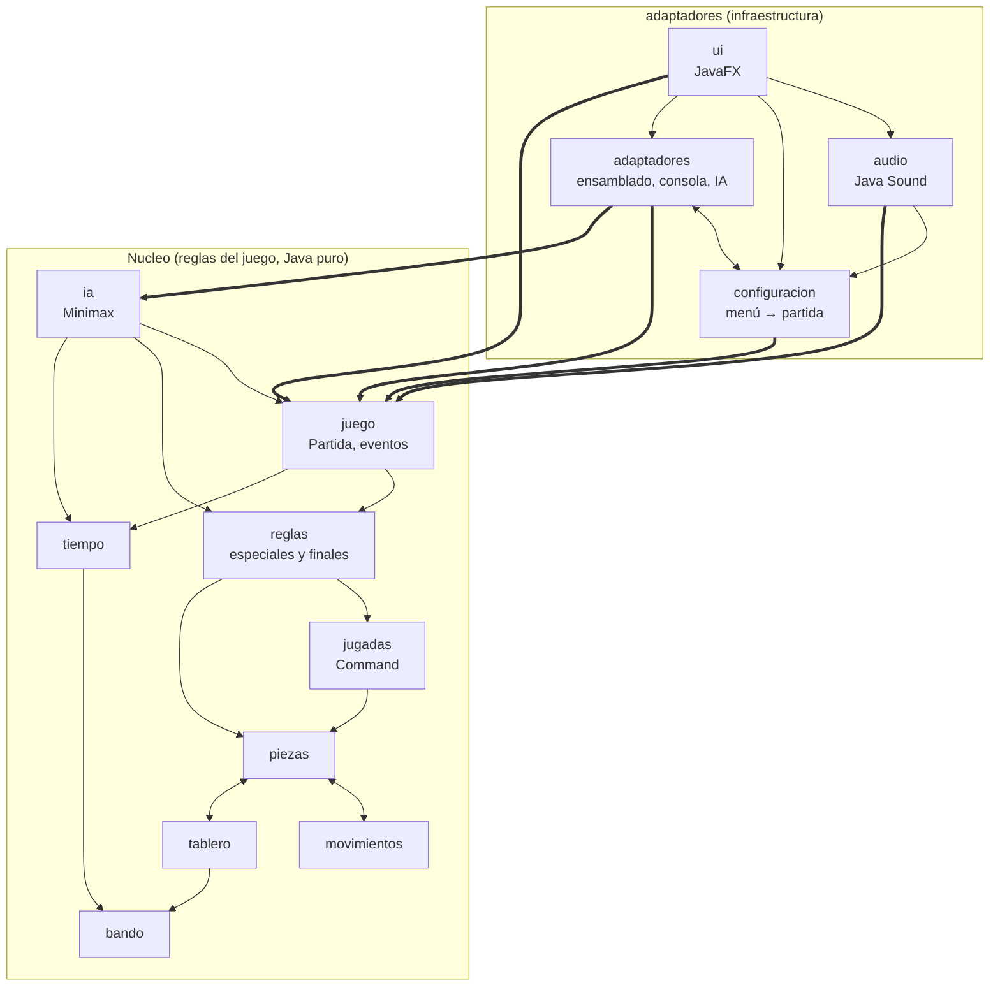

# 1. Vista general: paquetes y sentido de las dependencias

Cada flecha significa "usa". Todas las flechas que cruzan el borde van **desde los adaptadores hacia
el núcleo**: el núcleo no importa nada de afuera (ni JavaFX, ni Java Sound, ni archivos, ni hilos).
Lo que el núcleo necesita del exterior lo pide por interfaces propias, los **puertos**, que
implementa un adaptador.

## Puertos del núcleo

| Puerto (interfaz del núcleo) | Sentido | Lo implementa |
|---|---|---|
| `PartidaEnJuego` | los adaptadores juegan (mover, deshacer, rendirse, tablas) | `Partida`; lo usan la consola, el controlador del tablero y la IA |
| `ConsultaDePartida` | los adaptadores leen la partida y escuchan sus eventos | `Partida`; lo usa el sonido |
| `FuenteDeTiempo` | el núcleo pide la hora | `FuenteDeTiempoSistema` (real), relojes falsos en los tests |
| `ObservadorDePartida` | el núcleo avisa qué pasó | `SonidosDePartida`, `TurnoDeLaIa`; `VistaPartida` y `PanelEstadoPartida` (vía `ControladorTablero.escuchar`) |
| `EstrategiaDeJuego` | el adaptador pide una jugada | `JugadorArtificial` (núcleo); la usa `RivalArtificial` |
| `RelojPartida` | la partida controla el tiempo | `RelojAjedrez`, `SinReloj` (Null Object) |
| `java.util.Random` (inyectado) | azar de la IA | el ensamblado pasa uno real; los tests, uno con semilla |

Los adaptadores también tienen sus propios puertos, para no atarse a una tecnología:
`ReproductorDeAudio` (Java Sound), `RepresentacionPiezas` (sprites o Unicode) y `Sorteo` (azar del menú).

## Dependencias de ida y vuelta (aceptadas)

- `piezas ↔ tablero`: el tablero guarda piezas y cada pieza consulta el tablero para moverse.
- `piezas ↔ movimientos`: una pieza se define por sus reglas de movimiento, y las reglas miran qué
  pieza ocupa cada casilla para frenar o capturar.

La justificación está en [la decisión 3 del documento de justificación](../justificacion.md#3-paquetes-por-concepto-y-dependencias-en-un-solo-sentido).

La IA depende de la partida y no al revés: `ia → juego` porque recibe una
`juego.SituacionDePartida`. El paquete `juego` no conoce a la IA, que es un cliente más.

> **Punto a revisar:** `adaptadores ↔ configuracion`. El ensamblado lee la configuración, y
> `PartidaConfigurada` guarda un `RivalArtificial` (del paquete `adaptadores`).
