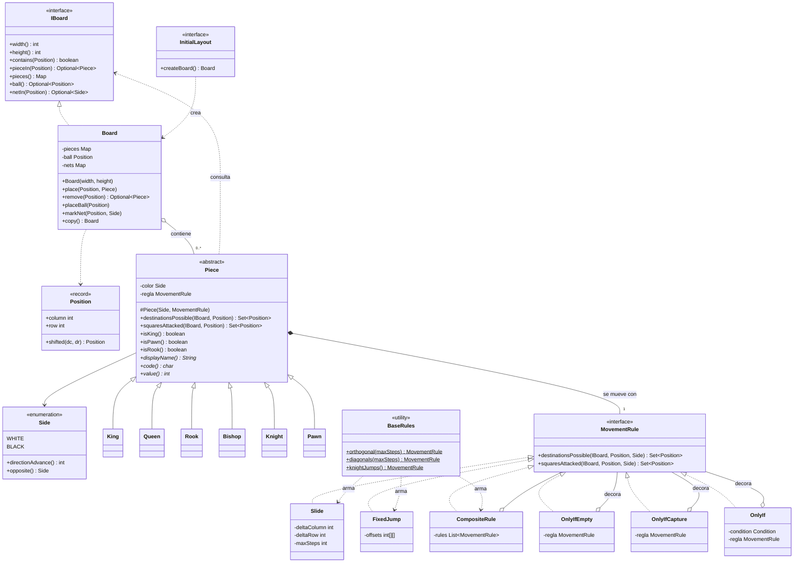

# 2. Tablero, piezas y movimientos

**Composición sobre herencia:** una pieza es un color más una `MovementRule`. Las subclases de
`Piece` solo eligen qué regla componer, cómo se llaman y cuánto valen; no reescriben cómo se mueven.
Por ejemplo, la reina es `CompositeRule(orthogonal, diagonals)`, y el peón envuelve deslizamientos
con los decoradores `OnlyIfEmpty`, `OnlyIfCapture` y `OnlyIf`.

Una pieza nueva se agrega con una subclase de `Piece` que combine reglas existentes. No hace falta
modificar ninguna clase.

## Qué arma cada pieza

| Pieza | Regla | `value()` |
|---|---|---|
| `Rook` | `orthogonal(WITHOUT_LIMIT)` | 500 |
| `Bishop` | `diagonals(WITHOUT_LIMIT)` | 330 |
| `Queen` | `CompositeRule(orthogonal, diagonals)` | 900 |
| `King` | `CompositeRule(orthogonal(1), diagonals(1))`; el enroque es una `SpecialRule` | 0 (nunca sale del tablero) |
| `Knight` | `knightJumps()` | 320 |
| `Pawn` | avance (`OnlyIfEmpty`) + avance doble (`OnlyIf` fila inicial) + capturas (`OnlyIfCapture`) | 100 |

`value()` es abstracto: una pieza nueva no compila hasta declarar cuánto vale. Así la IA no la
regala por creer que vale 0.

`InitialLayout` la implementan `StandardLayout` y `FootballLayout` (paquete `game`,
ver [diagrama 5](05-partida.md)). Un tablero de otro tamaño es otra `InitialLayout`.
