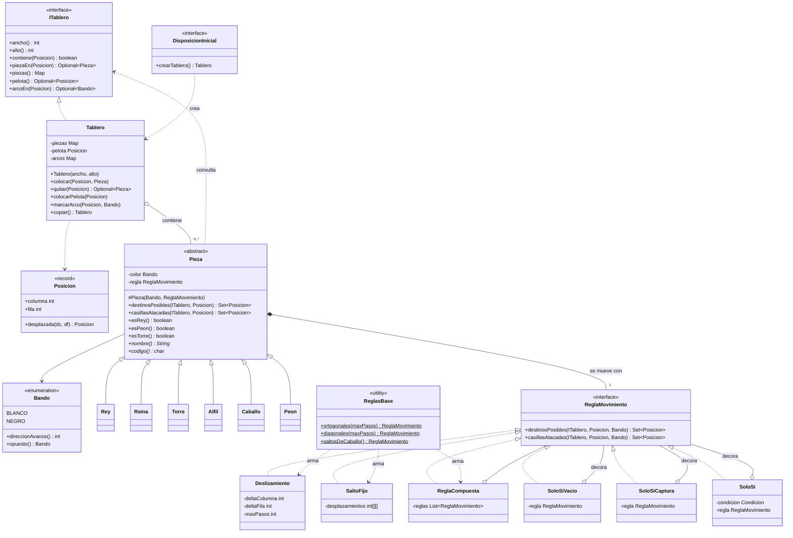

# 2. Tablero, piezas y movimientos

**Composición sobre herencia:** una pieza es un color más una `ReglaMovimiento`. Las subclases de
`Pieza` solo eligen qué regla componer y cómo se llaman; no reescriben cómo se mueven. Por ejemplo,
la reina es `ReglaCompuesta(ortogonales, diagonales)`, y el peón envuelve deslizamientos con los
decoradores `SoloSiVacio`, `SoloSiCaptura` y `SoloSi`.

Una pieza nueva se agrega con una subclase de `Pieza` que combine reglas existentes. No hace falta
modificar ninguna clase.

## Qué arma cada pieza

| Pieza | Regla |
|---|---|
| Torre | `ortogonales(SIN_LIMITE)` |
| Alfil | `diagonales(SIN_LIMITE)` |
| Reina | `ReglaCompuesta(ortogonales, diagonales)` |
| Rey | `ReglaCompuesta(ortogonales(1), diagonales(1))`; el enroque es una `ReglaEspecial` |
| Caballo | `saltosDeCaballo()` |
| Peón | avance (`SoloSiVacio`) + avance doble (`SoloSi` fila inicial) + capturas (`SoloSiCaptura`) |

`DisposicionInicial` la implementan `DisposicionEstandar` y `DisposicionDeFutbol` (paquete `juego`,
ver [diagrama 5](05-partida.md)). Un tablero de otro tamaño es otra `DisposicionInicial`.
