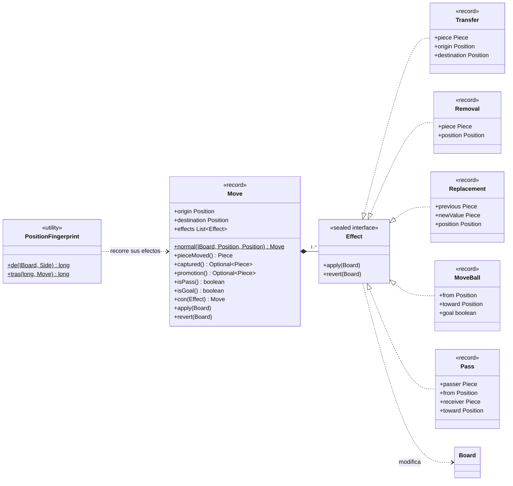

# 3. Jugadas y efectos (Command)

Toda jugada (`Move`) es una lista de **efectos** (`Effect`), y cada efecto sabe aplicarse y
revertirse. Así, todas las jugadas tienen la misma forma:

- una captura común es `[Removal, Transfer]`;
- un enroque son dos `Transfer`;
- la captura al paso es un `Removal` en otra casilla que el destino;
- la promoción agrega un `Replacement`;
- en el modo fútbol se suman `MoveBall` y `Pass`.

Por eso deshacer, la validación de jaque y la IA (que aplica y deshace jugadas imaginadas) funcionan
igual para todas.

`PositionFingerprint` calcula un número que identifica una posición (técnica de Zobrist) y lo
actualiza jugada a jugada. La usan las tablas por repetición y la IA.

`Effect` es **sellada** a propósito: si se agrega un efecto nuevo, el compilador obliga a decidir cómo
lo tratan la huella y los rasgos de los eventos. Esa es la excepción consciente a "agregar sin
modificar" (ver [la decisión 5 del documento de justificación](../justificacion.md#5-la-jugada-como-lista-de-efectos-command)).
