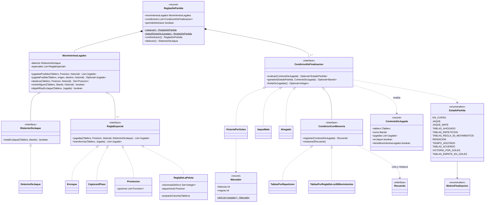

# 4. Reglas: movimientos legales, reglas especiales y finales (Strategy)

Las reglas se agrupan en `ReglasDePartida`, que es lo que recibe `Partida`. Hay dos puntos de
extensión, y los dos son el patrón Strategy:

- **`ReglaEspecial`** suma jugadas (enroque, captura al paso, pase) o transforma las que ya existen
  (promoción, gol).
- **`CondicionDeFinalizacion`** decide si la partida terminó y quién ganó.

Las condiciones que necesitan memoria (repetición, 50 movimientos) implementan `CondicionConMemoria`
y devuelven un `Recuerdo` en cada jugada (Memento), para poder deshacer.

## Las dos combinaciones que existen hoy

| Fábrica | Reglas especiales (en orden) | Condiciones de fin |
|---|---|---|
| `ReglasDePartida.clasicas()` | `Enroque`, `CapturaAlPaso`, `Promocion` | `JaqueMate`, `Ahogado`, `TablasPorRepeticion`, `TablasPorReglaDeLos50Movimientos` |
| `ReglasDePartida.futbol(n)` | las clásicas + `ReglaDeLaPelota` (después de `Promocion`) | `JaqueMate`, `VictoriaPorGoles(3, n)`, `Ahogado`, `TablasPorRepeticion`, `TablasPorReglaDeLos50Movimientos` |

Una regla nueva es una clase nueva que se agrega a una de estas listas. No hace falta tocar
`Partida` ni `MovimientosLegales`.
