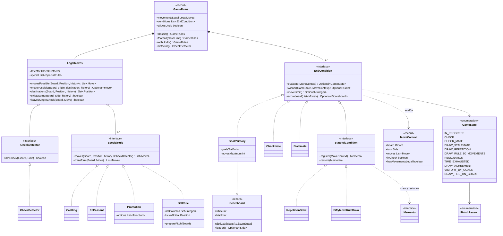

# 4. Reglas: movimientos legales, reglas especiales y finales (Strategy)

Las reglas se agrupan en `GameRules`, que es lo que recibe `Game`. Hay dos puntos de extensión, y
los dos son el patrón Strategy:

- **`SpecialRule`** suma jugadas (enroque, captura al paso, pase) o transforma las que ya existen
  (promoción, gol).
- **`EndCondition`** decide si la partida terminó y quién ganó. También informa si la partida tiene
  un límite de jugadas y un marcador de goles. Así `Game` y los adaptadores no necesitan saber qué
  condiciones existen ni preguntar si hay pelota.

Las condiciones que necesitan memoria (repetición, 50 movimientos) implementan `StatefulCondition`
y devuelven un `Memento` en cada jugada, para poder deshacer.

## Las dos combinaciones que existen hoy

| Fábrica | Reglas especiales (en orden) | Condiciones de fin |
|---|---|---|
| `GameRules.classic()` | `Castling`, `EnPassant`, `Promotion` | `Checkmate`, `Stalemate`, `RepetitionDraw`, `FiftyMoveRuleDraw` |
| `GameRules.football(n)` | las clásicas + `BallRule` (después de `Promotion`) | `Checkmate`, `GoalsVictory(3, n)`, `Stalemate`, `RepetitionDraw`, `FiftyMoveRuleDraw` |

Una regla nueva es una clase nueva que se agrega a una de estas listas. No hace falta tocar `Game`
ni `LegalMoves`.
