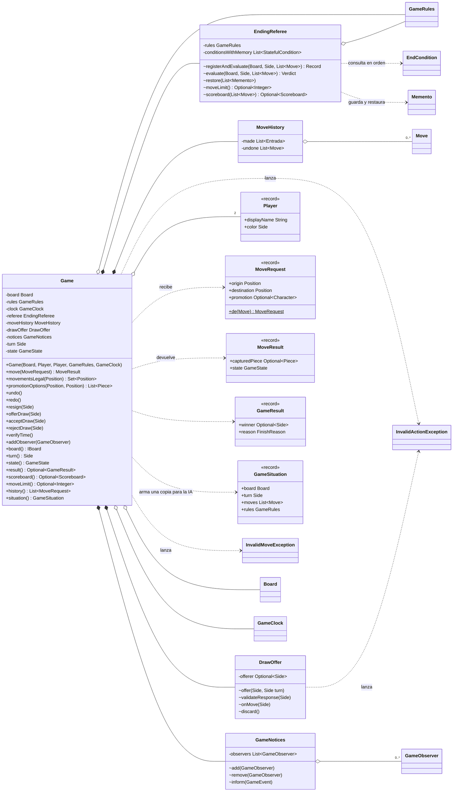
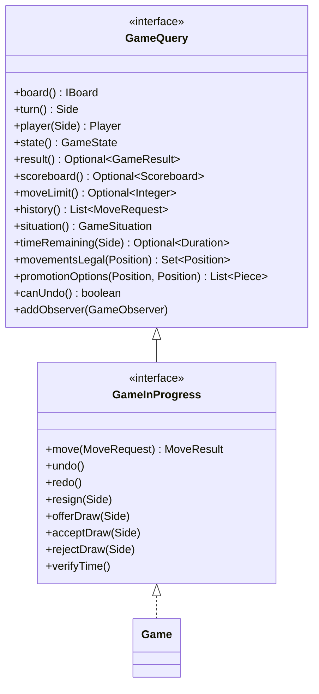
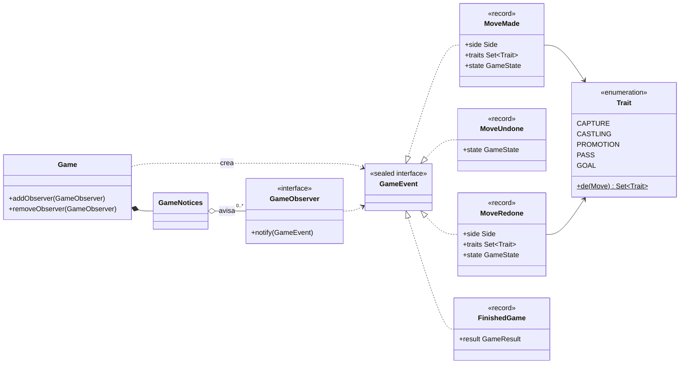
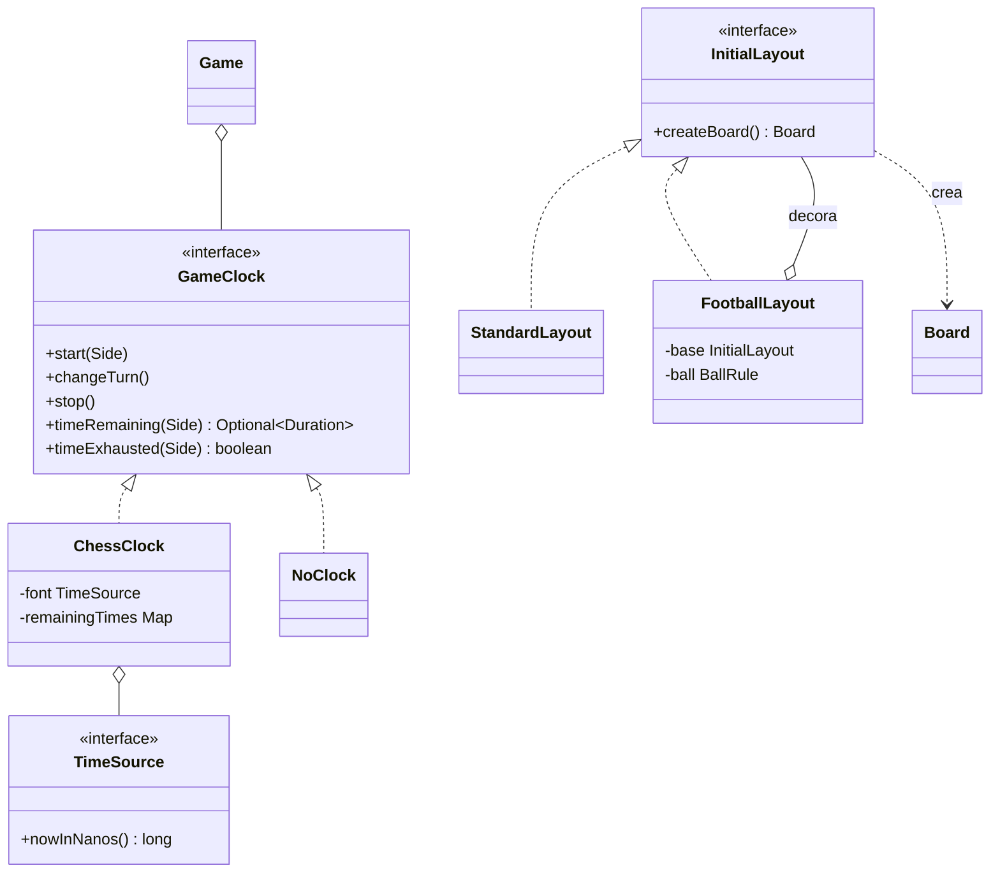

# 5. Partida, eventos y reloj

`Game` es la fachada del núcleo: recibe las órdenes de los jugadores (mover, deshacer, rendirse,
ofrecer tablas), las valida con las reglas y avisa lo que pasó a sus observadores. Todas sus
dependencias llegan por constructor (uno solo): el tablero, los jugadores, las reglas y el reloj.

`Game` coordina, y delega lo demás en cuatro clases privadas del paquete:

| Clase | Responsabilidad |
|---|---|
| `EndingReferee` | Decide si la partida terminó después de cada jugada y quién ganó; coordina la memoria de las condiciones (Memento) |
| `MoveHistory` | Las jugadas hechas y deshechas, con los recuerdos de cada una |
| `DrawOffer` | La oferta pendiente y sus reglas: quién puede ofrecer y quién responder |
| `GameNotices` | Los observadores y el envío de cada evento |

## 5a. Game y sus colaboradores

## 5b. Puertos de entrada: lo que ven los adaptadores

Los adaptadores no conocen la clase `Game`: reciben una de estas dos interfaces del núcleo. Solo
`GameAssembler` construye la `Game` concreta.

- **`GameQuery`** es de solo lectura, más la suscripción a los eventos. La recibe el sonido: por
  tipo, no puede mover piezas ni terminar la partida.
- **`GameInProgress`** suma las órdenes de los jugadores. La reciben la consola, el controlador del
  tablero, el rival artificial y el turno de la IA.

(En la interfaz de consulta se muestran los métodos principales; también tiene `currentPlayer`,
`winner`, `offerDrawPending`, `allowsUndo`, `canRedo` y `removeObserver`.)

## 5c. Eventos (Observer)

Los observadores son adaptadores (`GameSounds`, `AiTurn`, `GameView`, `GameStatePanel`): ver
[diagrama 7](07-adaptadores.md).

## 5d. Reloj y disposición inicial

## Patrones que se ven acá

- **Observer:** `Game` publica `GameEvent` y no sabe quién escucha (el sonido, el panel, la IA). El
  evento dice qué pasó, no cómo se muestra.
- **Command + Memento** para deshacer: el historial guarda cada `Move` (que sabe revertirse) junto con
  los `Memento` que devuelve el árbitro. `Game` es el cuidador: los guarda y los devuelve sin saber
  qué contienen.
- **Null Object:** `NoClock` evita preguntar "¿hay reloj?" en cada jugada.
- **Decorator:** `FootballLayout` envuelve cualquier disposición y le agrega la cancha.
- **Puerto de salida:** `TimeSource` es la única forma en que el núcleo conoce la hora.
- **Puertos de entrada con segregación de interfaces:** `GameQuery` y `GameInProgress`. Cada
  adaptador recibe solo lo que necesita (la I de SOLID) y depende de una abstracción del núcleo, no de
  la clase concreta (la D de SOLID).
