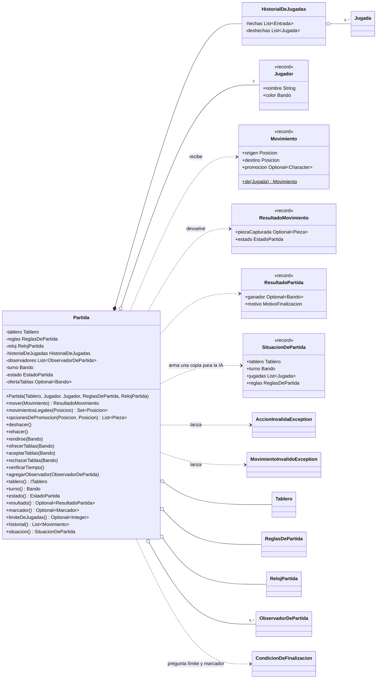
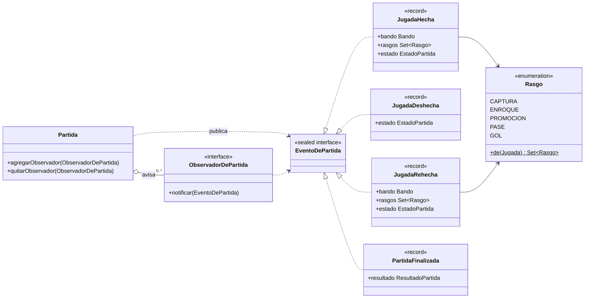
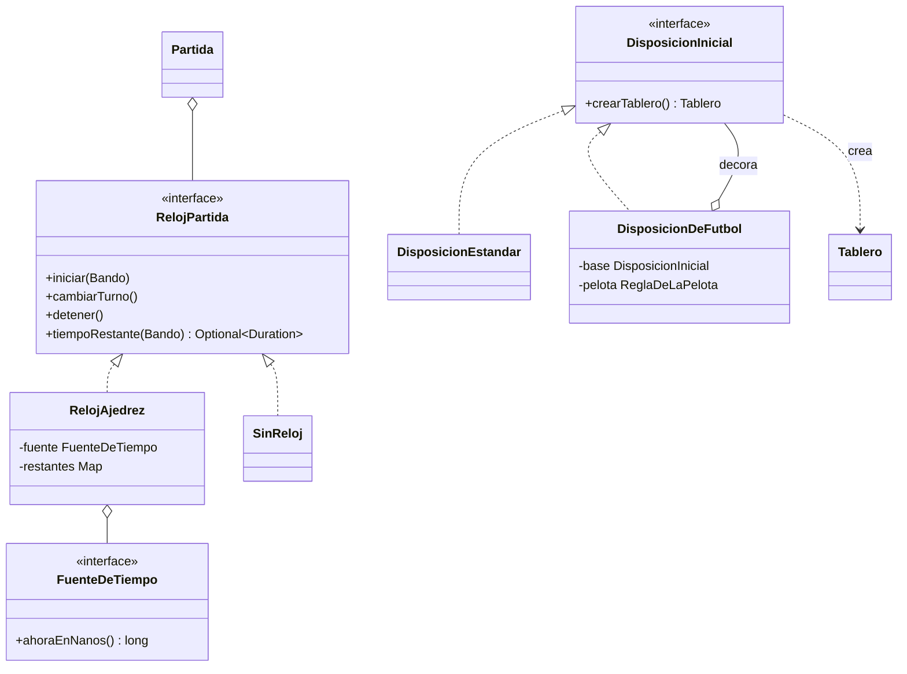

# 5. Partida, eventos y reloj

`Partida` es la fachada del núcleo: recibe las órdenes de los jugadores (mover, deshacer, rendirse,
ofrecer tablas), las valida con las reglas y avisa lo que pasó a sus observadores. Todas sus
dependencias llegan por constructor: el tablero, los jugadores, las reglas y el reloj.

## 5a. Partida y sus colaboradores

## 5b. Eventos (Observer)

Los observadores son adaptadores (`SonidosDePartida`, `TurnoDeLaIa`, `VistaPartida`,
`PanelEstadoPartida`): ver [diagrama 7](07-adaptadores.md).

## 5c. Reloj y disposición inicial

## Patrones que se ven acá

- **Observer:** `Partida` publica `EventoDePartida` y no sabe quién escucha (el sonido, el panel, la
  IA). El evento dice qué pasó, no cómo se muestra.
- **Command + Memento** para deshacer: el historial guarda cada `Jugada` (que sabe revertirse)
  junto con los `Recuerdo` de las condiciones con memoria.
- **Null Object:** `SinReloj` evita preguntar "¿hay reloj?" en cada jugada.
- **Decorator:** `DisposicionDeFutbol` envuelve cualquier disposición y le agrega la cancha.
- **Puerto de salida:** `FuenteDeTiempo` es la única forma en que el núcleo conoce la hora.
