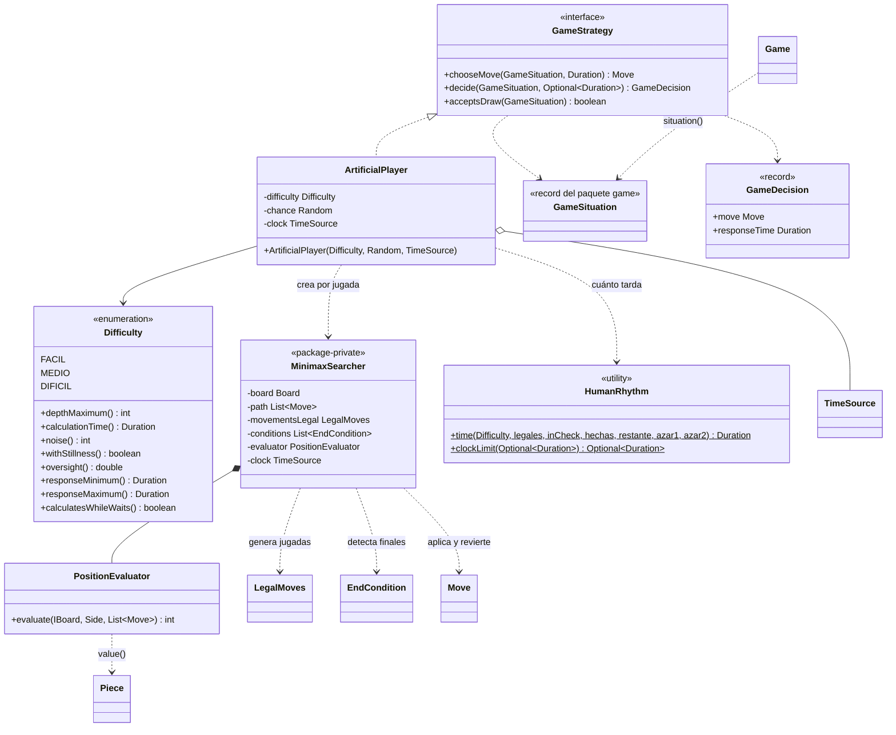

# 6. Inteligencia artificial

La IA es lógica del juego, así que vive en el núcleo (`core.ai`). Los adaptadores solo conocen la
interfaz `GameStrategy` (Strategy): otra IA sería otra implementación.

La IA nunca toca la `Game` real. Recibe una `GameSituation`, que trae una **copia** del tablero, el
historial y las reglas. Sobre esa copia aplica y deshace jugadas imaginadas con sus `Effect`. Así no
dispara eventos (no suena la hinchada mientras piensa) y puede pensar en otro hilo.

- `GameSituation` vive en el paquete `game` (ver [diagrama 5](05-partida.md)): la IA depende de la
  partida, y la partida no sabe que existe una IA.
- El material de cada pieza lo da `Piece.value()`, no el evaluador. Una pieza nueva cuenta para la IA
  con el valor que declara.

## Cómo se conecta con los adaptadores

`ArtificialRival` (adaptador) pide la situación a la partida, se la pasa a la `GameStrategy` y traduce
la jugada elegida a un `MoveRequest`. La consola la espera; la ventana la hace pensar en otro hilo
(`AiTurn`). Para el núcleo, la IA es un jugador más: mueve con `game.move(...)`, igual que un
humano. Ver [diagrama 7](07-adaptadores.md).

`MinimaxSearcher` implementa negamax con poda alfa-beta, profundización iterativa y búsqueda de
quietud. Es privado del paquete: nadie fuera de `ai` lo conoce.
