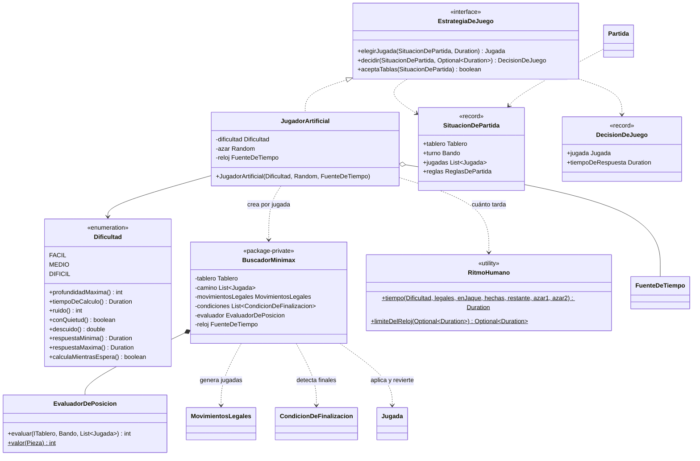

# 6. Inteligencia artificial

La IA es lógica del juego, así que vive en el núcleo (`Nucleo.ia`). Los adaptadores solo conocen la
interfaz `EstrategiaDeJuego` (Strategy): otra IA sería otra implementación.

La IA nunca toca la `Partida` real. Recibe una `SituacionDePartida`, que trae una **copia** del
tablero, el historial y las reglas. Sobre esa copia aplica y deshace jugadas imaginadas con sus
`Efecto`. Así no dispara eventos (no suena la hinchada mientras piensa) y puede pensar en otro hilo.

## Cómo se conecta con los adaptadores

`RivalArtificial` (adaptador) pide la situación a `Partida`, se la pasa a la `EstrategiaDeJuego` y
traduce la jugada elegida a un `Movimiento`. La consola la espera; la ventana la hace pensar en otro
hilo (`TurnoDeLaIa`). Para el núcleo, la IA es un jugador más: mueve con `partida.mover(...)`, igual
que un humano. Ver [diagrama 7](07-adaptadores.md).

`BuscadorMinimax` implementa negamax con poda alfa-beta, profundización iterativa y búsqueda de
quietud. Es privado del paquete: nadie fuera de `ia` lo conoce.
