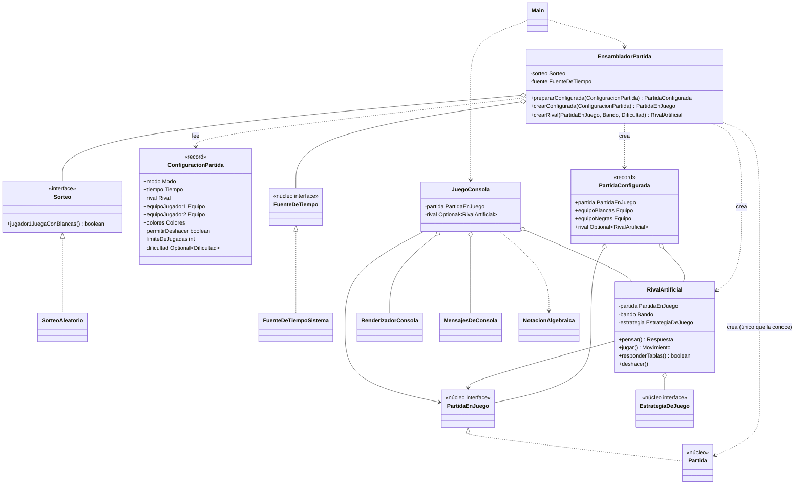
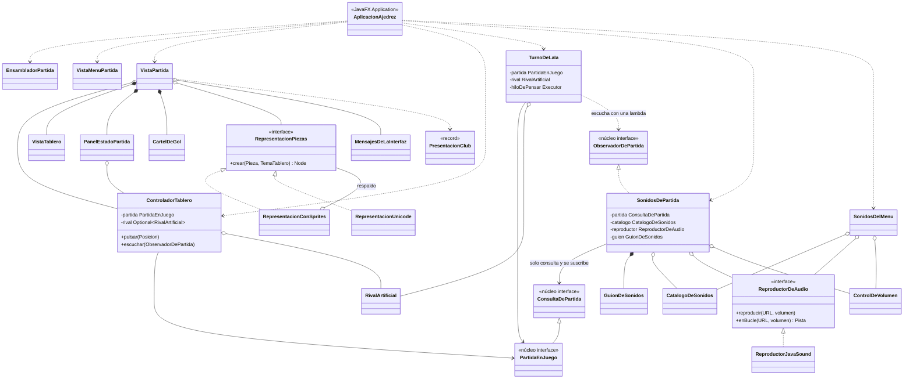

# 7. Adaptadores: ensamblado, consola, interfaz gráfica y sonido

Los adaptadores traducen entre el mundo exterior (teclado, mouse, pantalla, parlantes, reloj del
sistema) y el núcleo. **Ninguna clase del núcleo aparece acá con una flecha que salga de ella hacia
un adaptador.** Las clases del núcleo están marcadas con `<<núcleo>>`.

Los adaptadores hablan con la partida a través de los puertos de entrada del núcleo
(`PartidaEnJuego` y `ConsultaDePartida`, ver [diagrama 5](05-partida.md)). La clase concreta
`Partida` solo la conoce `EnsambladorPartida`, que la construye.

`EnsambladorPartida` y `AplicacionAjedrez` son las raíces de composición: el único lugar donde se
eligen las implementaciones concretas y se arman las partes de la partida (inyección de
dependencias manual, sin contenedor).

## 7a. Ensamblado, consola e IA

## 7b. Interfaz gráfica y sonido

## Qué hace cada grupo

| Grupo | Responsabilidad | Tecnología que encierra |
|---|---|---|
| Ensamblado (`EnsambladorPartida`, `configuracion`) | Traduce lo elegido en el menú a una partida armada; es el único que construye `Partida` | ninguna (Java puro) |
| Consola (`Main`, `JuegoConsola`, `RenderizadorConsola`, `NotacionAlgebraica`) | Juego por texto con notación algebraica | `System.in` / `System.out` |
| Interfaz gráfica (`ui`) | Menú, tablero, panel, relojes, cartel de gol | JavaFX |
| Sonido (`audio`) | Traduce eventos de la partida a sonidos | Java Sound (`javax.sound`) |
| IA (`RivalArtificial`, `TurnoDeLaIa`) | Decide cuándo le toca a la IA y en qué hilo piensa | `Executor` / hilo de JavaFX |

`GuionDeSonidos` decide **qué** suena con cada evento; `CatalogoDeSonidos` decide **qué archivo** es
(con sonidos propios de cada club); `ReproductorDeAudio` decide **cómo** se reproduce. Cada uno se
puede cambiar o probar por separado.
