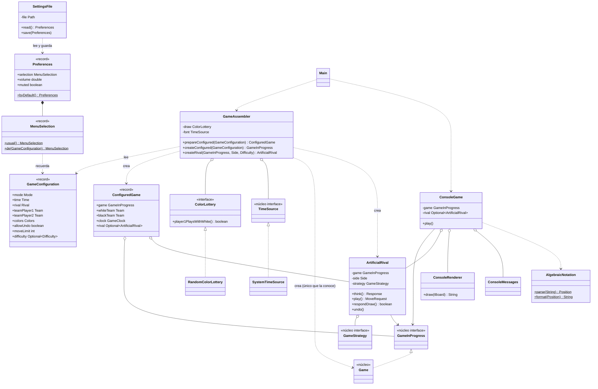
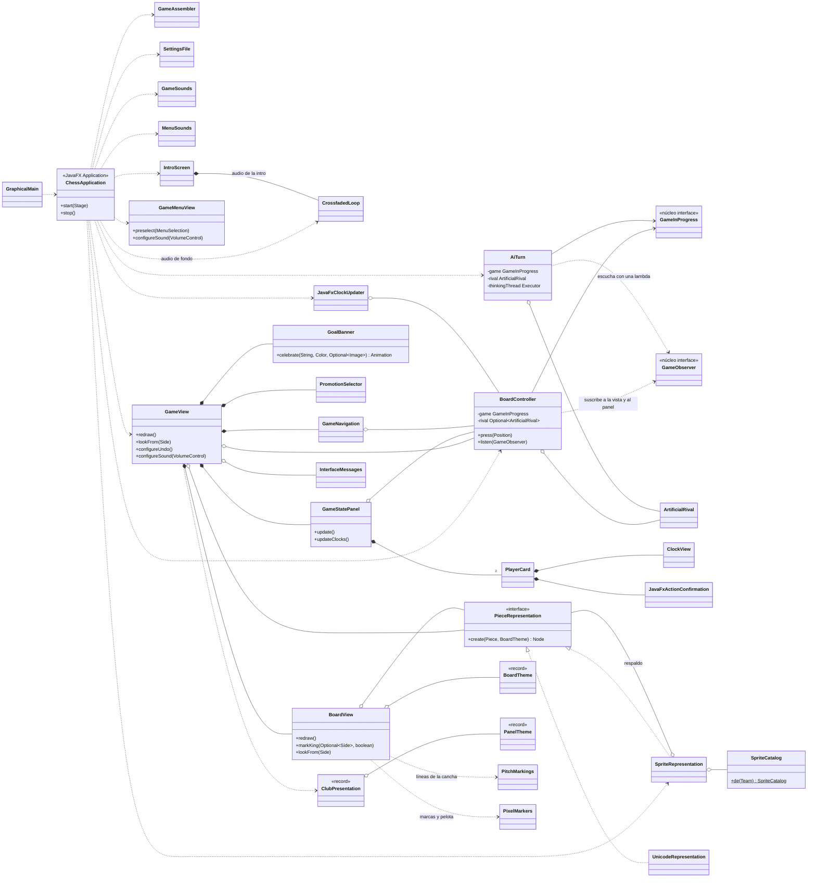
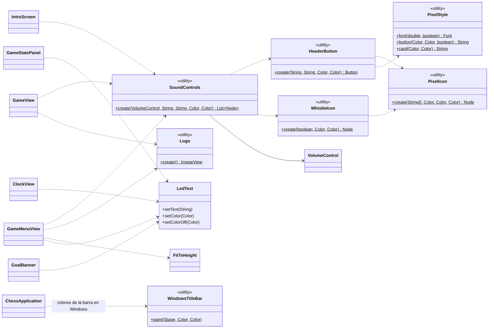
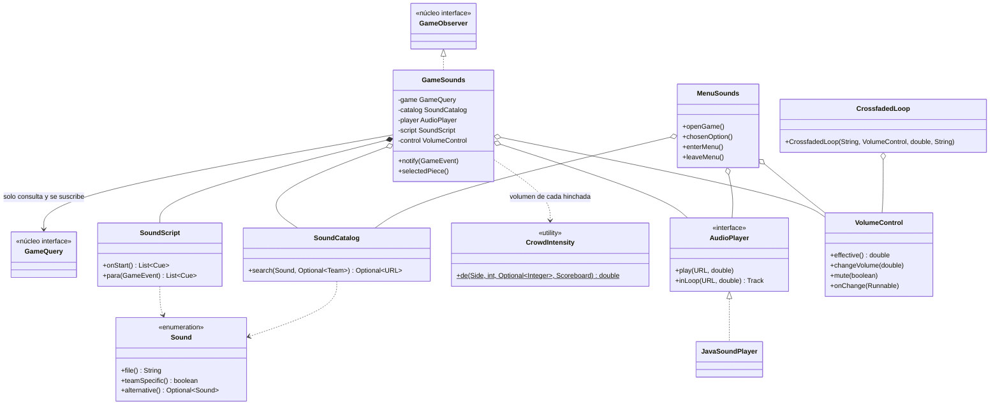

# 7. Adaptadores: ensamblado, consola, interfaz gráfica y sonido

Los adaptadores traducen entre el mundo exterior (teclado, mouse, pantalla, parlantes, reloj del
sistema, archivo de preferencias) y el núcleo. **Ninguna clase del núcleo aparece acá con una flecha
que salga de ella hacia un adaptador.** Las clases del núcleo están marcadas con `<<núcleo>>`.

Los adaptadores hablan con la partida a través de los puertos de entrada del núcleo
(`GameInProgress` y `GameQuery`, ver [diagrama 5](05-partida.md)). La clase concreta `Game` solo la
conoce `GameAssembler`, que la construye.

`GameAssembler` y `ChessApplication` son las raíces de composición: el único lugar donde se eligen
las implementaciones concretas y se arman las partes de la partida (inyección de dependencias
manual, sin contenedor).

| Diagrama | Qué muestra |
|---|---|
| 7a | Ensamblado, configuración, preferencias, consola e IA |
| 7b | Interfaz gráfica: la aplicación, el menú y la partida |
| 7c | Interfaz gráfica: componentes visuales en pixel art |
| 7d | Sonido |

## 7a. Ensamblado, configuración, consola e IA

Las opciones del menú y el volumen se guardan entre sesiones: `SettingsFile` las lee y las escribe en
`configuracion.txt` (en la carpeta desde donde se ejecuta el juego), como una `Preferences`.

## 7b. Interfaz gráfica: aplicación, menú y partida

## 7c. Interfaz gráfica: componentes visuales en pixel art

Piezas chicas y reutilizables que dan el estilo pixel art. Las usan casi todas las vistas de 7b; acá
se muestran solo las dependencias principales para no llenar el diagrama de flechas.

`WindowsTitleBar` pinta la barra de título de la ventana con los colores del juego usando JNA (una
biblioteca para llamar a funciones de Windows). En otros sistemas, o si algo falla, la barra queda como
estaba.

## 7d. Sonido

- `SoundScript` decide **qué** suena con cada evento; `SoundCatalog` decide **qué archivo** es (con
  sonidos propios de cada club); `AudioPlayer` decide **cómo** se reproduce. Cada uno se puede
  cambiar o probar por separado.
- `CrossfadedLoop` (paquete `ui`) reproduce el audio de fondo de la partida y de la pantalla de intro
  con JavaFX Media, y funde el final de cada vuelta con el principio de la siguiente.

## Qué hace cada grupo

| Grupo | Responsabilidad | Tecnología que encierra |
|---|---|---|
| Ensamblado (`GameAssembler`, `configuration`) | Traduce lo elegido en el menú a una partida armada; es el único que construye `Game` | ninguna (Java puro) |
| Preferencias (`SettingsFile`, `Preferences`, `MenuSelection`) | Recuerda las opciones del menú y el volumen entre sesiones | un archivo de texto |
| Consola (`Main`, `ConsoleGame`, `ConsoleRenderer`, `AlgebraicNotation`) | Juego por texto con notación algebraica | `System.in` / `System.out` |
| Interfaz gráfica (`ui`) | Intro, menú, tablero, panel, relojes, cartel de gol, estilo pixel art | JavaFX, JavaFX Media, JNA |
| Sonido (`audio`) | Traduce eventos de la partida a sonidos | Java Sound (`javax.sound`) |
| IA (`ArtificialRival`, `AiTurn`) | Decide cuándo le toca a la IA y en qué hilo piensa | `Executor` / hilo de JavaFX |
