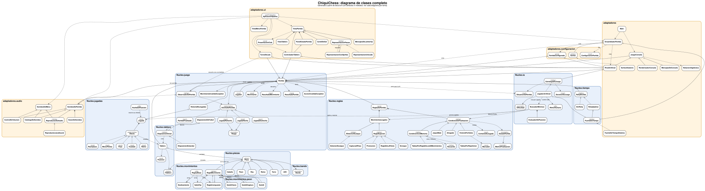

# Diagrama de clases de ChiquiChess

Los diagramas están escritos en [Mermaid](https://mermaid.js.org/) dentro de archivos Markdown.
GitHub los dibuja solo al abrir cada archivo. En VS Code se ven con la vista previa de Markdown, si
está instalada la extensión "Markdown Preview Mermaid Support".

Están escritos **a partir del código**, no al revés. Al cambiar una clase, se actualiza el diagrama
en el mismo commit.

## Todo en una imagen

[](uml-completo.svg)

[`uml-completo.svg`](uml-completo.svg) tiene todas las clases agrupadas por paquete y todas sus
relaciones, sin atributos ni métodos. Se puede ampliar sin perder calidad. También está
[`uml-completo.png`](uml-completo.png) para la presentación.

- **Naranja:** adaptadores. **Azul:** núcleo.
- Todas las flechas que cruzan del naranja al azul van **hacia el núcleo**.

Se generó a partir de los diagramas de abajo, así que no puede contradecirlos.
[`uml-completo.dot`](uml-completo.dot) es su fuente en formato Graphviz.

### Regenerarla después de cambiar un diagrama

1. Correr el script; solo necesita Python:

   ```powershell
   python docs/uml/generar/generar.py
   ```

   - Lee los diagramas por tema y actualiza `uml-completo.dot`.
   - Si un diagrama nombra una clase que no existe en `src/main/java`, avisa y no genera nada.
2. Abrir `docs/uml/generar/dibujar.html` en el navegador. Necesita internet para cargar Graphviz.
3. Con los botones, descargar `uml-completo.svg` y `uml-completo.png`, y reemplazar los de `docs/uml/`.

## Por tema

| # | Diagrama | Qué muestra |
|---|---|---|
| 1 | [Vista general](01-vista-general.md) | Paquetes, sentido de las dependencias y puertos del núcleo |
| 2 | [Tablero, piezas y movimientos](02-tablero-piezas-movimientos.md) | Composición de las piezas con reglas de movimiento |
| 3 | [Jugadas](03-jugadas.md) | La jugada como lista de efectos (Command) |
| 4 | [Reglas](04-reglas.md) | Movimientos legales, reglas especiales y condiciones de fin (Strategy, Memento) |
| 5 | [Partida (Game)](05-partida.md) | La fachada del núcleo, eventos (Observer) y reloj |
| 6 | [IA](06-ia.md) | Minimax detrás de `EstrategiaDeJuego` |
| 7 | [Adaptadores](07-adaptadores.md) | Ensamblado, configuración, consola, interfaz gráfica y sonido |

## Cómo leerlos

| Notación | Significa |
|---|---|
| `A <\|-- B` (flecha con triángulo, línea llena) | B hereda de A |
| `A <\|.. B` (triángulo, línea punteada) | B implementa la interfaz A |
| `A *-- B` (rombo lleno) | A está compuesto por B: B nace y muere con A |
| `A o-- B` (rombo vacío) | A tiene un B que recibe de afuera (inyectado) |
| `A --> B` | A conoce a B y lo usa de forma permanente |
| `A ..> B` (punteada) | A usa B de paso: lo crea, lo recibe o lo devuelve |
| `<<interface>>`, `<<record>>`, `<<enumeration>>` | Tipo de declaración en Java |
| `$` al final de un método | Método estático |
| `*` al final de un método | Método abstracto |

Para no repetir, cada clase se detalla en un solo diagrama. En los demás aparece solo con su nombre.

Las justificaciones de cada decisión están en [`docs/justificacion.md`](../justificacion.md).
